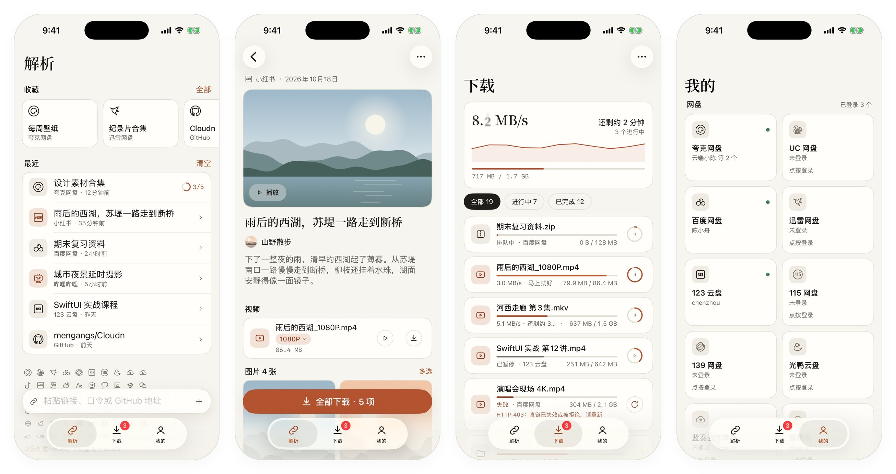
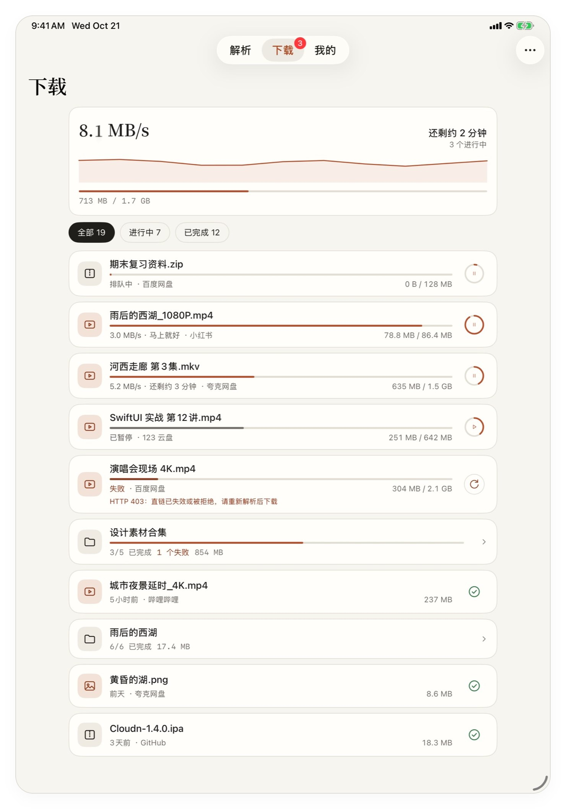
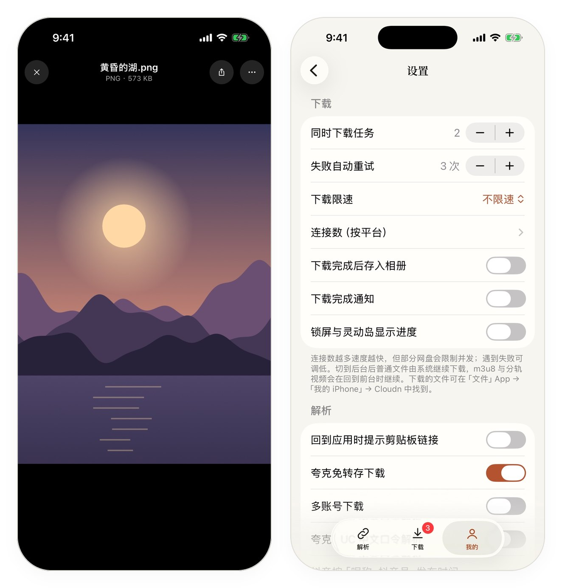

<div align="center">

<picture>
  <source media="(prefers-color-scheme: dark)" srcset="docs/assets/icon-dark.png">
  
</picture>

# Cloudn

**粘贴一个链接，剩下的交给它。**

网盘分享、短视频、网页视频、GitHub、磁力链接，一个 App 解析、预览、高速下载。

[](https://github.com/mengangs/Cloudn/releases/latest)
[](#安装)
[](#参与开发)
[](https://github.com/mengangs/Cloudn/actions/workflows/ci.yml)
[](LICENSE)

开源免费 · 无广告 · 无服务器 · 所有解析在手机本地完成

[**下载 v1.0.0**](https://github.com/mengangs/Cloudn/releases/latest) · [支持的平台](#支持的平台) · [功能一览](#功能一览) · [常见问题](#常见问题)

<br>

<picture>
  <source media="(prefers-color-scheme: dark)" srcset="docs/assets/screenshots/showcase-dark.jpg">
  
</picture>

<sub>解析 · 作品详情 · 下载 · 我的　—　跟随系统浅色 / 深色，主题色可自定义</sub>

</div>

---

## 为什么是 Cloudn

- **一个输入框就够了**：复制链接打开 App，剪贴板里的分享会自动识别；提取码、口令、带文案的整段分享文字都能直接粘贴。
- **快**：多连接分片并发、断点续传，锁屏或切到后台由系统接着下载，完成后发通知；进度显示在锁屏和灵动岛上。
- **清晰度由你挑**：抖音、哔哩哔哩、YouTube、X 等平台列出全部画质，默认选最高的原画。
- **网页里的视频也能下**：专门解析不了的网站，在内置浏览器里打开，自动嗅探正在播放的视频；只有 blob 流的网页可以边播边录。
- **你的数据只在你的手机上**：除了平台自己的接口，Cloudn 不调用任何第三方服务（唯一例外是夸克 / UC 中文口令，见下文，需你同意才会使用）；登录凭证只存在系统钥匙串里。

<details>
<summary><b>更多截图：iPad、图片查看、设置</b></summary>
<br>

<picture>
  <source media="(prefers-color-scheme: dark)" srcset="docs/assets/screenshots/ipad-dark.jpg">
  
</picture>

<picture>
  <source media="(prefers-color-scheme: dark)" srcset="docs/assets/screenshots/extras-dark.jpg">
  
</picture>

</details>

## 支持的平台

### 网盘分享

| 平台 | 免登录 | 登录后 |
|---|---|---|
| 夸克网盘 · UC 网盘 | 浏览；夸克小文件、UC 直接下载 | 不限大小下载、转存、管理我的网盘 |
| 百度网盘 · 迅雷网盘 | 浏览 | 下载（临时转存取直链，取完即删）、转存、管理 |
| 115 网盘 | 浏览、小文件下载 | 大文件下载、转存、管理 |
| 123 云盘 · 139 网盘 | 浏览 | 下载、转存、管理 |
| 光鸭云盘 | 公开分享直接下载 | 分享者关闭免登录下载时也能下、转存、管理 |
| 蓝奏云 · 蓝奏云优享版 | 直接下载 | 管理我的网盘、转存（优享版） |
| 阿里云盘 | 浏览 | 下载、转存、管理我的网盘（资源库 / 备份盘）、上传（支持秒传） |
| Google 云端硬盘 | 浏览、下载（文件夹整批下载；Google 文档 / 表格 / 幻灯片自动导出为 Word / Excel / PowerPoint） | Google 账号登录后管理我的网盘、上传、把公开分享里的文件复制到自己的盘，分享可设任何人查看 / 编辑并可取消 |
| OneDrive | 浏览、下载（个人版与工作或学校版，支持密码分享） | 微软账号登录后管理我的网盘、上传，分享可设谁能访问 / 查看或编辑 / 有效期 / 密码，并可取消已有分享 |

提取码自动识别；迅雷中文口令可以直接粘贴。OneDrive 个人版（1drv.ms）与工作或学校版（SharePoint）的分享都支持，设了密码的分享填上密码即可。夸克 / UC 的中文口令只能在夸克 App 里还原，Cloudn 可以把口令文字发给第三方「星海」服务换取分享链接——只发口令文字、不含任何账号信息，首次使用前会征得你同意，可在设置中关闭。

### 短视频与图集（近 50 个平台）

| 地区 | 平台 |
|---|---|
| 国内 | 抖音、快手、小红书、哔哩哔哩、微博、微信视频号、微信公众号、知乎、今日头条、西瓜视频、AcFun、百度贴吧、豆瓣、酷安、小黑盒、皮皮虾、最右、好看视频、微视、全民K歌、抖音火山版、梨视频、绿洲、美拍、皮皮搞笑、新片场、虎牙、央视网、Pixiv、Bangumi |
| 海外 | YouTube、X（Twitter）、TikTok、Instagram、Threads、Facebook、Reddit、Pinterest、Tumblr、Imgur、Bluesky、Snapchat、Vimeo、Dailymotion、Twitch、SoundCloud、Medium |

视频去水印、图集取原图，Live 图、动图、多 P、合集一并支持。部分平台登录后能看更多（如 B 站 1080P+、小红书、知乎、视频号、Threads 登录墙内的帖子）。

### 其他链接

- **任意网页**：内置浏览器嗅探 mp4 / m3u8 / 音频，下载前就能看到每个视频的大小、时长和清晰度。
- **GitHub**：仓库、Release、raw 链接，浏览目录、下载附件，支持私有仓库和下载镜像。
- **磁力 / BT**：磁力链接或 .torrent 文件，选择要下载的文件，逐块校验。
- **直链**：文件直链、m3u8（含 AES-128 加密）。

## 功能一览

### 解析

- **批量**：一次粘贴多条链接；YouTube 播放列表、B 站合集 / 多 P、SoundCloud 歌单、**抖音 / 快手作者主页**都能整批加入下载，可勾掉不要的。
- **画质选择**：所有清晰度一目了然，带大小和分辨率；默认最高画质。
- **字幕**：YouTube、B 站 CC 字幕一键存成 SRT，和视频一起出现在下载列表里。
- **网页录制**：只能在网页里播放的视频（MSE / blob），开始录制后播放即可保存，从中途开始录也能得到时间正确的 MP4。

### 下载

- 多连接分片、断点续传；直链过期自动重新取链。
- 后台与锁屏继续下载，完成后发通知；实时活动显示在锁屏和灵动岛。
- 全局限速、失败重试次数、按平台设置连接数、网络代理。
- m3u8 / TS 自动转成 MP4，B 站等分离的音视频无损合成一个文件。
- 文件夹、合集在下载页归成可折叠的分组。
- 下载完成的文件在「文件」App →「我的 iPhone」→ Cloudn 里，也可一键存入相册，或自动移动到 iCloud 云盘等任意文件夹。

### 网盘

- **转存到我的网盘**：单个、多选或整个目录，逐级挑选目标文件夹。
- **我的网盘**：浏览、下载、上传（支持秒传）、新建文件夹、重命名、移动、删除、创建分享链接、查看容量。
- **多账号**：同一网盘登录多个账号，批量下载时轮换取链；大文件可以多个账号同时分片下载。
- **登录状态一眼可见**：账号旁的小圆点，绿色有效、红色已失效。

### 更顺手

- 分享扩展：在 Safari、微信里「分享 → Cloudn」直接解析。
- 收藏与最近记录；长按主屏幕图标「粘贴并解析」；`cloudn://resolve?text=<链接>` 供快捷指令调用。
- 在线播放、图片查看、文本预览，下载前先看一眼。
- 浅色 / 深色 / 跟随系统，自定义主题色，平台图标线性或实心任选。
- 账号凭证可用口令加密导出备份，换机导入。
- App 内检查更新，可直接下载新版 IPA。

## 安装

Cloudn 没有上架 App Store，可以通过以下方式安装：

1. 在 [Releases](https://github.com/mengangs/Cloudn/releases/latest) 下载最新版 `Cloudn-vX.Y.Z.ipa`（附带 `SHA256SUMS.txt` 可校验）；想尝鲜可以在 [Actions](https://github.com/mengangs/Cloudn/actions) 最近一次成功运行的 Artifacts 里取 `Cloudn-unsigned-ipa`。
2. IPA 未签名，用 AltStore、SideStore、Sideloadly、TrollStore 等工具签名安装，需要 iOS 17 及以上。
3. 以后 App 内「设置 › 检查更新」会提示新版本，可直接下载。

> 部分企业证书 / 重签安装下，系统不允许 App 直接访问外部文件夹：「完成后保存到」选文件夹没反应时，在下载页点「选择」，勾选文件后用「存储到「文件」」导出即可。

也可以自己编译：用 Xcode 16 打开 `Cloudn.xcodeproj`，选择你的开发者团队后运行。

## 隐私

完整说明见 [隐私政策](PRIVACY.md)。

- 所有解析都在手机上完成，直接访问各平台自己的接口；没有 Cloudn 服务器，不收集任何数据。
- 登录信息只保存在系统钥匙串，网页登录使用独立的会话，不与 Safari 共享。
- YouTube 签名、个别平台的兜底解析在手机本地的 JavaScriptCore / 隐藏网页里运行。
- 微信视频号借助腾讯自家的元宝接口解析，需要你登录元宝账号。
- Google 云端硬盘 / OneDrive 用官方 OAuth 登录，令牌只存在钥匙串；可随时在 Google / 微软账号设置里撤销授权。
- 夸克 / UC 中文口令是唯一会用到第三方服务（「星海」）的地方：只在你同意后发送口令文字，不发送账号信息；在「设置 › 解析」里可以随时关闭。

## 常见问题

<details>
<summary><b>为什么有些网盘要登录才能下载？</b></summary>

百度、迅雷、115（大文件）等平台不给未登录用户下载地址。登录后 Cloudn 会把文件临时转存到你的网盘取直链，下载开始后立即删除，不占你的空间。阿里云盘的分享也要登录后才能下载，但不需要转存。
</details>

<details>
<summary><b>视频解析失败怎么办？</b></summary>

先确认链接能在浏览器里打开。部分内容需要登录对应平台（在「我的 › 账号」里登录）；仍然失败时，点「用网页嗅探」在内置浏览器里打开页面，播放后就能抓到视频。
</details>

<details>
<summary><b>支持优酷、爱奇艺、腾讯视频吗？</b></summary>

不支持。这些长视频平台使用 DRM 版权加密，无法下载；直播流也暂不支持。
</details>

<details>
<summary><b>下载的文件在哪？</b></summary>

「文件」App →「我的 iPhone」→ Cloudn。也可以在「设置 › 下载」里设置完成后自动移动到其他文件夹，例如 iCloud 云盘。
</details>

<details>
<summary><b>Instagram 登录页是空白的？</b></summary>

Instagram 会直接拒绝部分 VPN / 机房线路（返回 429 空白页），App 会提示「当前网络被站点拒绝」。换一个节点或改用家庭网络后再登录即可，这不是 App 能绕开的。
</details>

<details>
<summary><b>抖音保存到相册能按作者命名吗？</b></summary>

可以。在「设置 › 解析」打开「抖音按「昵称_抖音号_发布时间」命名」，下载和存入相册的文件名就会是这种格式。
</details>

<details>
<summary><b>切到后台还会继续下载吗？</b></summary>

会。普通文件交给系统后台下载，锁屏也能继续，完成后发通知。m3u8 和磁力下载需要 App 留在前台。
</details>

## 参与开发

<details>
<summary>项目结构与本地测试</summary>

```
Cloudn.xcodeproj        Xcode 工程（同步文件夹，新增文件无需手动加入）
Cloudn/                 SwiftUI 应用：App（全局状态）、Services、Views、Assets
CloudnShare/            分享扩展
CloudnWidget/           实时活动（锁屏与灵动岛）
CloudnKit/              与界面无关的核心 Swift Package，可在 Linux 上编译测试
  Share/                网盘链接识别与解析、转存、我的网盘
  Video/                短视频平台解析
  Download/             分片下载引擎、HLS、TS 转封装、BT
  Support/              HTTP、JSON、摘要与加解密
design/                 应用图标与平台图标的生成脚本
docs/assets/            README 用图
```

```bash
cd CloudnKit
python3 Tests/Server/test_server.py 8765 &
CLOUDN_TEST_SERVER=http://127.0.0.1:8765 swift test
```

每次推送，CI 都会在 Linux / macOS 上运行测试并构建未签名 IPA；另有每日在线巡检，用真实链接检查海外平台的解析是否仍然有效。
</details>

欢迎提 Issue 反馈失效的平台或新需求，请附上出问题的链接（可打码）和 App 版本。

## 许可与致谢

Cloudn 以 [GNU AGPL-3.0](LICENSE) 发布。

Cloudn 是独立开发的应用，与 YunX 项目及其作者没有关联；但其中部分网盘与视频平台的协议实现参考了开源项目 [YunX](https://github.com/CYQawa/YunX)（AGPL-3.0），依照该许可，Cloudn 的源代码同样以 AGPL-3.0 开放，相关文件头部已注明来源。

Google 云端硬盘分享的解析参考了 [gdown](https://github.com/wkentaro/gdown)（MIT License，Copyright (c) 2015 Kentaro Wada）；阿里云盘（含个人盘的设备签名）与 OneDrive 工作或学校版分享参考了 [OpenList](https://github.com/OpenListTeam/OpenList)（AGPL-3.0）。

其他视频平台的解析分别参考了 [ParseHub](https://github.com/z-mio/ParseHub)（MIT License，Copyright (c) 2024 梓澪）、[parse-video](https://github.com/wujunwei928/parse-video)（MIT License，Copyright (c) 2022 wujunwei928）与 [yt-dlp](https://github.com/yt-dlp/yt-dlp)（Unlicense）；YouTube 签名求解脚本取自 yt-dlp-ejs（Unlicense，内含 meriyah / ISC 与 astring / MIT）。

- 线性平台图标改绘自 [Arcticons](https://github.com/Arcticons-Team/Arcticons)（CC BY-SA 4.0，阿里云盘亦取自其中）；115、光鸭、蓝奏云、蓝奏优享、AcFun、Google Drive、OneDrive 及后来新增的其他平台为本项目按同规格绘制（CC BY-SA 4.0）
- 实心平台图标中百度、哔哩哔哩、抖音、快手、微博、小红书、Pixiv、GitHub、Google Drive 取自 [Simple Icons](https://simpleicons.org)（CC0 1.0），其余由本项目绘制（CC BY-SA 4.0）
- 标题字体为[思源宋体](https://github.com/notofonts/noto-cjk)子集（SIL Open Font License 1.1）
- 各平台名称与标识归其所有者，仅用于标明来源

## 免责声明

本项目仅供个人学习与技术交流，不得用于商业用途。请只解析你有权访问的内容，遵守各平台服务条款与当地法律法规。各平台接口随官方调整可能失效。
